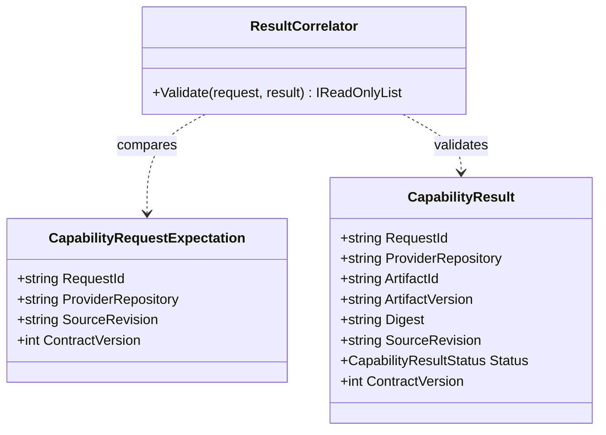

# ResultCorrelator UML and Use Case

**Owner moniker:** The Singularity Workshop  
**Purpose:** correlate a provider result with the exact request, provider identity, source revision, and contract version.

## Use case

1. Parent coordinator obtains authoritative request identity.
2. Provider reports result metadata.
3. CogC emits stable mismatch codes instead of guessing or silently repairing identity.
4. Coordinator separately verifies provider CI evidence, artifact integrity, local validation, and consumer acceptance.
