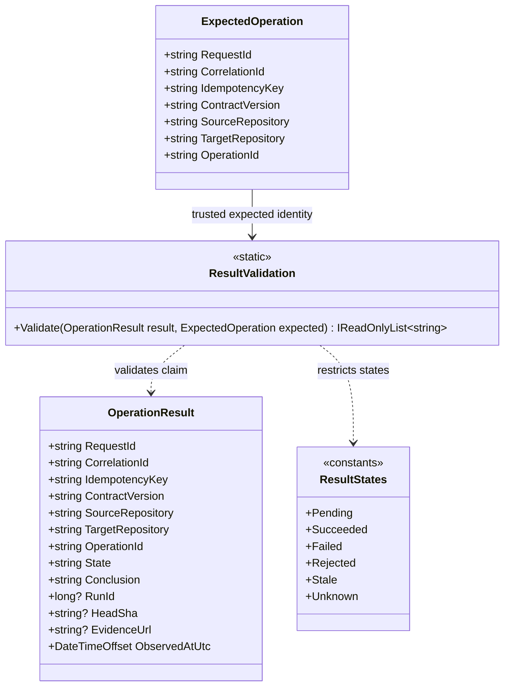

# ResultValidation — UML Class Card and Use Case

**User moniker:** CogC Result and Correlation Boundary

## UML class card

## Use case: validate a provider outcome

1. The coordinator retains the original request identity and constructs `ExpectedOperation`.
2. A provider or transport supplies an `OperationResult` claim.
3. `ResultValidation.Validate` compares request/correlation/idempotency IDs, contract version, source/target repository, and operation.
4. The validator returns stable error identifiers for invalid fields or mismatches.
5. If the claim says `succeeded`, the coordinator separately retrieves the authoritative GitHub Actions run and compares repository, run ID, conclusion, and head SHA.
6. Only the coordinator decides whether evidence is sufficient to accept the result.

## Boundary

This diagram describes implemented CogC types and validation. It does not imply a callback receiver, transport, cryptographic callback authentication, replay persistence, or end-to-end CogB/CiAi integration.
