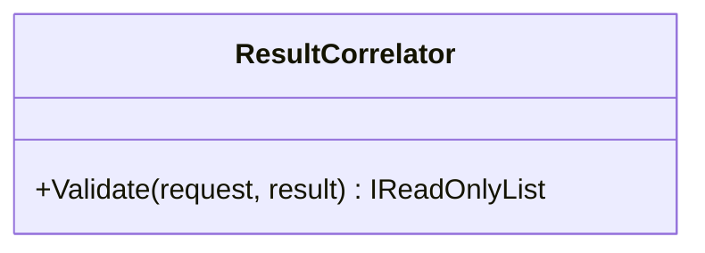

# ResultCorrelator

**Owner moniker:** The Singularity Workshop  
**Purpose:** correlate provider result metadata with the exact request, provider repository, source revision, and contract version.

## Responsibility

Correlate provider result metadata with the exact request, provider repository, source revision, and contract version. The class provides a bounded, dependency-free control-plane primitive. It does not perform remote execution, grant implicit permission, or replace authoritative provider evidence.

## UML class card

For the focused class diagram and use case, see [ResultCorrelator UML](../../docs/UML/ResultCorrelatorUML.md).
